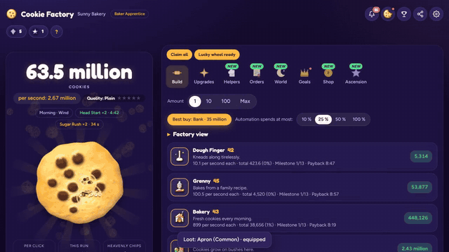

<div align="center">

# 🍪 Cookie Factory · Keksfabrik

**Bake, build and conquer the cookie universe!**<br>
*Backe, baue und erobere das Keks-Universum!*

[](https://destinyx350.github.io/Cookie-Factory/)
[](https://destinyx350.itch.io/cookie-factory)


<a href="https://destinyx350.github.io/Cookie-Factory/docs/trailer.mp4"></a>

🎬 [Watch the trailer](https://destinyx350.github.io/Cookie-Factory/docs/trailer.mp4) · 🌐 [Game website](https://destinyx350.github.io/Cookie-Factory/welcome.html) · 🎮 [itch.io](https://destinyx350.itch.io/cookie-factory)


</div>

---

## 🎮 About the game

Cookie Factory is a free idle game you play right in your browser, on desktop or phone. Click the big cookie, build a factory, hire helpers, and grow from a *Baker Apprentice* into a cookie tycoon.

<div align="center">

</div>

### ✨ Features

| | |
| --- | --- |
| 🏭 **23 buildings** | From the Dough Finger to the Cookie Singularity. Each one shows its output, payback time and progress to the next milestone, as a list or a compact grid. |
| ⬆️ **349 upgrades** | Make buildings and clicks much stronger. Turn on auto upgrades or use *Buy all*. |
| 🤖 **Automation** | *Best buy* picks the smartest purchase, and you choose how much of your cookies automation may spend. |
| 🧑‍🍳 **Helpers** | Helpers buy buildings, harvest, fight or trade, and level up with experience. |
| 🌍 **World** | Adventure, stores, a lucky wheel, titles, a pass and a collection to complete. |
| 🏆 **192 achievements** | Plus guided *First Steps* goals, detailed statistics and charts of your cookies and production over time. |
| 📅 **Daily rewards** | A 7-day login streak and three daily tasks with a bonus chest. Coming back shows what happened while you were away, with one **Collect all** button, and after 3+ days a welcome-back gift. |
| 👼 **Ascension** | Start over for heavenly chips and spend them in the ascension tree. |
| 🎵 **Soundtrack and 3D** | 7 music tracks with real instruments that adapt to what you do, and a real 3D cookie with lighting that tilts toward your finger. Golden cookies and icons have a 3D look too. |
| ☀️ **Living world** | Time of day and weather change while you play. Combos and boosts speed things up. |
| 💾 **Named saves** | Progress saves automatically in 3 save slots. Every new game gets a name, which shows at the top of the screen. |
| 🎁 **Secret codes** | Type a code under **Settings → Game** to get cookies, gems or a boost. Each code works once per save. |
| 📁 **Save files** | Download your save as a file and load it on another device. |
| 📱 **Install as an app** | Add the game to your home screen. It opens full-screen and works offline. |
| 📐 **Fits every device** | A clean, modern design with separate layouts for phones (upright and sideways), tablets and computers, picked automatically or in **Settings → Display**. Reorder or hide tabs, and phones vibrate softly on taps and achievements. Options for high contrast, less motion and bigger text. |
| 👤 **Accounts** | Create an account with a username and password (no email needed). Your bakery is saved to it automatically, so you can keep playing on any device. A one-time recovery code resets a forgotten password, and you can see and sign out each signed-in device. |
| 👥 **Bakery clubs** | Start or join a club of up to 30 bakers, chat live with your club (with reactions, a 👋 button and a pinned message), and bake together for weekly prizes for the top 3 clubs. Clubs level up to level 10, and every level gives all members more production and bigger prizes. |
| 🎁 **Gifts** | Send gems or star crumbs to friends with an account (daily limits keep it fair). |
| 🤝 **Friends and profiles** | Add friends, see who's online, and tap any name to see that player's profile. Style your own profile with an avatar, color, motto and favourite achievements, and share it with a link. |
| ⚔️ **Club wars** | Every weekend your club faces a club of similar strength. Winners collect trophies and gems. |
| 💌 **Invites** | Share your invite link; when a friend starts playing through it, you both get a bonus. |
| 🌍 **Online features** | Global events (like double production for everyone), announcements, a live "bakeries online" counter and server codes. Events and announcements can be planned ahead. |
| 🔔 **Push notifications** | Get notified about gifts, friend requests, club prizes and events, even when the game is closed, and get a reminder after 3 days away. |
| 🔄 **Instant updates** | New versions load right away, and a notice at the top lets you update while playing. |
| 📣 **Share button** | Show your friends how many cookies your bakery has baked. Shared links show a preview card. |
| 🏆 **Leaderboard** | Tap the trophy at the top (or open the **Goals** tab), join with your bakery name and see your rank (creating an account joins automatically). Extra boards for most clicks, golden cookies, ascensions and the fastest billion this week. With an account, your spot follows you to every device. **This week** and **This month** boards give the top 3 gems, star crumbs and cookies. Updates every minute. |
| 🛡️ **Anti-cheat and safety** | Saves are sealed: a save changed outside the game (browser tools or edited files) is flagged, the leaderboard rejects scores that grow too fast, and the server flags account saves that jump unrealistically. Flagged saves and saves that used the admin panel can't join the leaderboard. A word filter, a report button in club chat and per-device limits keep things friendly. |
| 🔒 **Separate admin version** | Players get the game without any admin code. The owner uses a separate admin version that needs a password, and the online tools have a second password with a lockout after wrong tries and optional two-step sign-in. Moderators get their own logins that can only handle reports and mutes. The admin can moderate reports, find players, mute, ban accounts (for a while or for good, with the reason shown to the player, who can appeal), rename, send messages and gifts, switch features on and off, run maintenance mode, see statistics and an admin log, start new leaderboard seasons, download backups (made automatically every week), read crash reports and player feedback, see how far new players get (day 2 and day 7 return rates), compare each week with the one before, get push alerts for new reports, appeals, feedback, crashes and suspicious saves, plan events and announcements (once or every week), see how full the database is, follow a live dashboard with charts, get an automatic weekly report with to-dos every Monday, and see server health (installed server parts, server jobs, alarms for stuck push messages, crash spikes and a full database, plus an uptime check every 30 minutes). Old data is cleaned up automatically and an encrypted copy of the weekly backup is kept outside Supabase. |
| 💬 **Feedback and privacy** | Send bug reports and ideas from Settings → Game. The [privacy info](https://destinyx350.github.io/Cookie-Factory/privacy.html) explains what the game stores. |
| 🇩🇪 🇬🇧 **Two languages** | Switch between German and English at any time. |

### 🕹️ How to play

1. Press **Play!** and tap the big cookie. Every click bakes cookies.
2. Spend cookies on **buildings** that bake for you automatically.
3. Check the **Upgrades** tab often. Upgrades make buildings and clicks much stronger.
4. Claim your **goals**, **daily rewards** and the **lucky wheel**.
5. When progress slows down, **ascend** for heavenly chips and come back stronger.

---

## 🇩🇪 Über das Spiel

Keksfabrik ist ein kostenloses Idle-Spiel, das direkt im Browser läuft, am Computer und auf dem Handy. Klicke auf den großen Keks, baue deine Fabrik aus, stelle Helfer ein und werde vom *Bäckerlehrling* zum Keks-Tycoon.

- 🏭 **23 Gebäude** mit Ertrag, Amortisationszeit und Fortschritt zum nächsten Meilenstein, als Liste oder Raster
- ⬆️ **349 Upgrades**, auf Wunsch automatisch gekauft
- 🤖 **Automatik**: *Bester Kauf* und ein einstellbares Ausgabelimit
- 🧑‍🍳 **Helfer**, die kaufen, ernten, kämpfen oder handeln und dabei aufsteigen
- 🌍 **Welt** mit Abenteuer, Läden, Glücksrad, Titeln, Pass und Sammlung
- 🏆 **192 Erfolge**, Ziele, Statistiken und Verlaufs-Diagramme deiner Kekse und Produktion
- 📅 **Tägliche Belohnungen**: 7-Tage-Serie, drei Tagesaufgaben, eine Zusammenfassung mit „Alles einsammeln“ nach jeder Pause und ein Willkommensgeschenk nach 3+ Tagen
- 👼 **Aufstieg** für Himmelschips und den Himmelsbaum
- 🎵 **Soundtrack und 3D**: 7 Musikstücke mit echten Instrumenten, die sich anpassen, und ein echter 3D-Keks mit Licht, der sich zum Finger neigt
- 💾 **Spielstände mit Namen**: 3 Speicherplätze, jedes neue Spiel bekommt einen Namen
- 🎁 **Geheime Codes** unter **Einstellungen → Spiel**: Kekse, Edelsteine oder ein Schub, einmal pro Spielstand
- 📁 **Spielstand als Datei** herunterladen und auf einem anderen Gerät laden
- 📱 **Als App installieren**: auf dem Startbildschirm, im Vollbild und ohne Internet
- 📐 **Passt auf jedes Gerät**: klares, modernes Design mit eigenen Layouts für Handy (hochkant und quer), Tablet und Computer; eigene Tab-Reihenfolge, sanfte Vibration auf Handys, dazu hoher Kontrast, weniger Bewegung und größere Schrift
- 👤 **Konten**: Benutzername und Passwort (ohne E-Mail), deine Bäckerei auf jedem Gerät, Wiederherstellungs-Code bei vergessenem Passwort und eine Liste aller angemeldeten Geräte
- 👥 **Bäckerei-Clubs** mit bis zu 30 Mitgliedern, Live-Club-Chat mit Reaktionen und angehefteter Nachricht, Wochenpreisen für die Top 3 und Club-Stufen bis 10 mit Bonus für alle Mitglieder
- 💬 **Feedback senden** unter Einstellungen → Spiel und eine [Datenschutz-Info](https://destinyx350.github.io/Cookie-Factory/privacy.html)
- 🎁 **Geschenke**: Edelsteine oder Sternenkrümel an Freunde mit Konto schicken
- 🤝 **Freunde und Profile**: sieh, wer online ist, und tippe auf Namen für das Profil; gestalte dein Profil mit Avatar, Farbe, Motto und Lieblings-Erfolgen und teile es per Link
- ⚔️ **Clubkriege** jedes Wochenende mit Trophäen und Edelsteinen
- 💌 **Einladungen**: Wer über deinen Link anfängt, bringt euch beiden einen Bonus
- 🌍 **Online-Funktionen**: globale Events, Ankündigungen (auch im Voraus geplant), Live-Zähler und Server-Codes
- 🔔 **Push-Benachrichtigungen** für Geschenke, Freundschaftsanfragen, Club-Preise, Events und eine Erinnerung nach 3 Tagen Pause
- 🔄 **Sofortige Updates**: neue Versionen kommen gleich an, oben erscheint ein Hinweis zum Aktualisieren
- 📣 **Teilen-Knopf**: zeig deinen Freunden, wie viele Kekse du gebacken hast
- 🏆 **Bestenliste**: tippe oben auf den Pokal (oder öffne den Tab **Ziele**) und mach mit deinem Bäckerei-Namen mit (mit einem neuen Konto bist du automatisch dabei); eigene Listen für Klicks, Goldkekse, Aufstiege und die schnellste Milliarde der Woche; Wochen- und Monatspreise für die Top 3, Updates jede Minute
- 🛡️ **Schutz gegen Schummeln**: versiegelte Spielstände, die Bestenliste lehnt zu schnell wachsende Punkte ab, und der Server meldet unrealistische Sprünge in Konto-Spielständen; dazu Wortfilter, Melde-Knopf im Club-Chat und Limits pro Gerät
- 🔒 **Eigene Admin-Version** (das Spiel für Spieler enthält keinen Admin-Code) mit Passwort, eigenem Server-Passwort und Zwei-Schritt-Anmeldung für die Online-Werkzeuge, dazu Moderatoren-Zugänge: Meldungen, Spielersuche, Stummschalten, Sperren mit Einspruch, Wochenbericht, Spieler-Feedback, Push-Alarme, Nachrichten, Schalter, Wartungsmodus, Statistik, Protokoll, Saisons, Absturzberichte, geplante Events und Ankündigungen, Live-Dashboard mit Diagrammen, Wochenbericht jeden Montag, Server-Gesundheit mit Alarmen und Uptime-Check, verdächtige Spielstände, Datenbank-Füllstand, automatisches Aufräumen und verschlüsselte Backups außerhalb von Supabase und Spieler-Weg
- 🇩🇪 🇬🇧 **Deutsch und Englisch**

**[▶ Jetzt spielen](https://destinyx350.github.io/Cookie-Factory/)**

---

## 📝 What's new · Neuigkeiten

### Version 62
- **New accounts join the leaderboard right away:** when you create an account, your bakery is on the leaderboard at once, including the boards for clicks, golden cookies, ascensions and the fastest billion. If your bakery name is already taken, it uses your username. You can leave any time with **Leave** in the leaderboard.

Also new since version 61: more leaderboards (clicks, golden cookies, ascensions, fastest billion) and your own profile with an avatar, a color, a motto and favourite achievements.

<details>
<summary>Deutsch</summary>

- **Neue Konten sind gleich in der Bestenliste:** wer ein Konto erstellt, ist mit seiner Bäckerei sofort in der Bestenliste, auch in den Listen für Klicks, Goldkekse, Aufstiege und die schnellste Milliarde. Ist der Bäckerei-Name schon vergeben, nimmt sie den Benutzernamen. Mit **Austreten** in der Bestenliste kannst du jederzeit wieder raus.

Außerdem neu seit Version 61: mehr Bestenlisten (Klicks, Goldkekse, Aufstiege, schnellste Milliarde) und dein eigenes Profil mit Avatar, Farbe, Motto und Lieblings-Erfolgen.

</details>

Older updates are listed in the game under **What's New**.

---

## 💻 Run it locally

Players get a single `index.html` file. It is built from the parts in `src/` with `node tools/build.js` (no other tools needed), which also builds `admin.html`, the owner's version with the admin panel. `manifest.webmanifest`, `sw.js` and the `icons` folder make it installable as an app. Download the files and open `index.html` in your browser, or serve the folder:

```bash
python3 -m http.server 8000
```

Then open http://localhost:8000.

A gameplay trailer is recorded automatically with `node tools/trailer.js` (writes `docs/trailer.mp4`, `docs/trailer.jpg` and `docs/trailer.gif`; `--phone` makes an upright version for social media). The game website is `welcome.html`.

For game portals (itch.io, CrazyGames, …) `node tools/portal.js` builds an upload folder in `dist/portal/`. GitHub also builds it as a download after every update; see [docs/PORTALS.md](docs/PORTALS.md) for the steps and store texts.

Automatic tests run on every change; see [tests/README.md](tests/README.md).

To switch on the leaderboard, follow [docs/LEADERBOARD.md](docs/LEADERBOARD.md). Push notifications: [docs/PUSH.md](docs/PUSH.md).

<div align="center">
<sub>Made with 🍪 by <a href="https://github.com/Destinyx350">Destinyx350</a></sub>
</div>
